<a href="https://yashkhou.com">
  <picture>
    <source media="(prefers-color-scheme: dark)" srcset="assets/lab-dark.svg">
    
  </picture>
</a>

I'm Josh, an applied AI builder in Dubai. My work sits where an AI agent meets real people: what it can safely handle by itself, what it should pass to a person, and proof afterwards of what it actually did.

### How my tools fit together

<picture>
  <source media="(prefers-color-scheme: dark)" srcset="assets/run-dark.svg">
  
</picture>

Each tool call is checked against its contract and written to a ledger that can't be quietly rewritten. The page and the file are checked instead of taking the agent's word for it. If anything doesn't add up, a person takes over.

### What I'm building

| | |
| --- | --- |
| **[Commander Plus](https://github.com/yashkhou/commander-plus-mcp)** | My daily driver. It extends [DesktopCommanderMCP](https://github.com/wonderwhy-er/DesktopCommanderMCP) so ChatGPT and other MCP clients can do real work on my Mac. 129,811 tool calls in its first three weeks. |
| **[RunLedger](https://github.com/yashkhou/runledger)** | A tamper-evident record of what an agent actually did. Edit, delete or reorder one step and verification fails. |
| **[Verify](https://github.com/yashkhou/verify)** | Checks an agent's output without trusting the agent: documents, code and reversible actions. Three packages on [npm](https://www.npmjs.com/~joshuakhoury). |
| **[BrowserProof](https://github.com/yashkhou/browserproof)** | Proves a browser agent really ended up where it says it did. |
| **[ActionMesh](https://github.com/yashkhou/actionmesh)** | One typed contract for each thing an agent is allowed to call. |
| **[Agent Reliability Lab](https://github.com/yashkhou/agent-reliability-lab)** | Twelve small tools that break agent infrastructure on purpose, before production does. |
| **[Glyph](https://github.com/yashkhou/glyph)** | An experiment: a design language agents can reason about, instead of pixels. |

### How I work

I design the system and plan each feature. AI coding agents type most of the code. I review what they write, test it hard, and fix what they get wrong myself.

### Lately, upstream

- **Merged:** a `/warden` rules command in [pi-warden #82](https://github.com/DevMortimer/pi-warden/pull/82)
- **Merged:** broken README links fixed in [Stellar-agentic #429](https://github.com/StellarAgent-AI-Agent-Payment-Rails/Stellar-agentic/pull/429)
- **Reviewed:** a schema leak between output types in [pydantic-ai #8969](https://github.com/pydantic/pydantic-ai/pull/8969)
- **Open:** an installable agent skill for [cc-hooks-ts #455](https://github.com/sushichan044/cc-hooks-ts/pull/455)

**[yashkhou.com](https://yashkhou.com)** · [X](https://x.com/yashkhou) · [LinkedIn](https://www.linkedin.com/in/thebrokerjosh)
